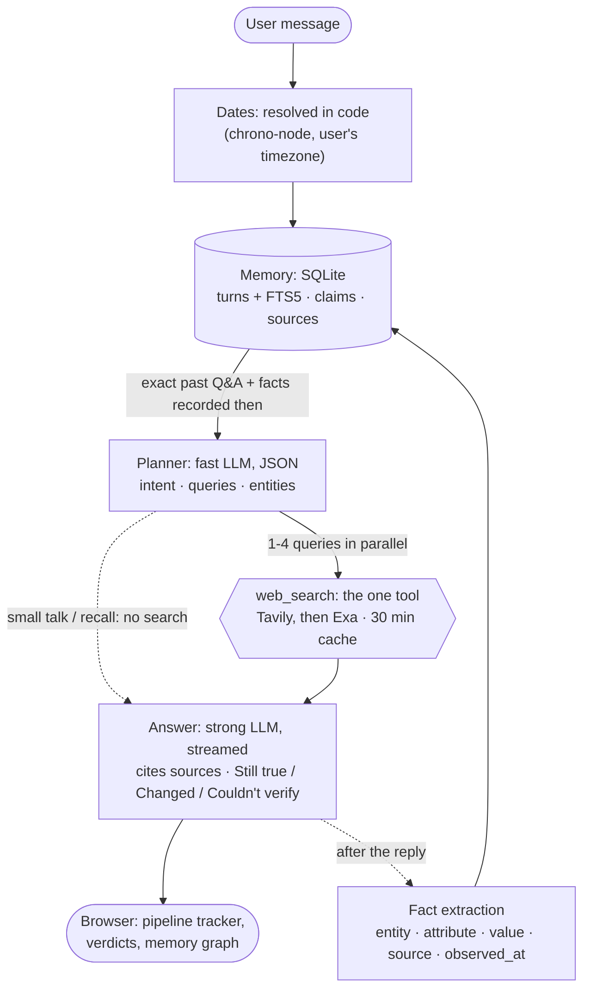

# DESIGN

**The key observation:** the test questions aren't search questions, they're *memory* questions. "What did I ask on 3 November, is it still correct?" needs four things: resolve the date, recall the exact exchange, know what facts it rested on, and re-check those facts against the web. So time and facts are the core data here, not chat logs added on afterwards. It's minimi's own problem in miniature: remember what was said and when, and notice when it goes stale.

## How it works

1. **Dates in code.** "Last Tuesday", "on Monday" and "3 November" become exact local days. A weekday in the future is moved back a week. The answer says which date it used.
2. **Memory is context, not a tool.** The brief allows one tool. Recall is deterministic: SQL by date range, plus FTS5 for "earlier I asked about Supabase". It returns the question, the answer and the **facts recorded then**. If nothing matches, the prompt says so and the agent answers "no record" instead of inventing one.
3. **Planner** (fast model) sees the message plus a memory summary. Re-checks get one query per remembered entity, so the 5 CRMs become 5 parallel searches. Small talk skips planning and search.
4. **Answer** streams with numbered citations. "Is it still correct?" follows a fixed structure, with the date each old fact was recorded.
5. **Facts back to memory.** After the reply, a cheap call extracts facts that can change (`entity · attribute · value · source · observed_at`). "Has pricing changed?" then becomes a row-by-row diff, not the model re-reading old prose.

## Why this way

- **Speed:** memory is ~1 ms of SQL, there's one small planning call, searches run in parallel, the answer streams, and the memory write happens after the reply. There's no model → tool → model loop. Measured on free tiers (11 eval cases): first word p50 **3.1 s** and p95 **5.4 s** with search, **0.9 s** for small talk.
- **Reliability on free tiers:** one OpenAI-compatible client covers Gemini, Groq, OpenAI (or any compatible server), DeepSeek and OpenRouter, with a fallback order per role. A model that hasn't answered in 12 s, or produced its first token in 15 s, is put on cooldown and the next one takes over. Retired model names are dropped. Keys and order can be set in a Settings page, and the API never returns them.
- **Correctness you can test:** dates and recall are code (`npm test`, 13 tests), and `npm run eval` runs 11 end-to-end cases with deterministic checks: searched? cited? said "no record"? stated the date it used?
- **Runs anywhere:** built-in `node:sqlite` (no native build, no database server) and a single-file UI. The memory graph is ~200 lines of canvas, with no library.

## Considered and rejected

- **LangChain / multi-agent graphs:** more layers and latency for a linear pipeline, and harder to explain line by line.
- **Vercel AI SDK:** good, but one small client over a single protocol is easier to explain and makes fallback across providers trivial.
- **Memory as a second tool, or letting the model resolve dates:** breaks the one-tool rule, adds a round trip, and models get "which day was last Tuesday?" wrong.
- **Vector DB / embeddings:** *time* is the main key here. Date range + FTS5 covers recall without an external service.
- **Zep/Graphiti temporal knowledge graph:** the right idea (timestamped facts, never overwrite) at the wrong size. I borrowed the idea, not the dependency.
- **A page-fetch tool or provider-hosted search:** a second tool, or no control over sources, caching and the then-vs-now diff.

## With another week

- **Proactive re-checks:** "watch these 5 CRMs" → a scheduled re-search → a nudge only when a fact actually changes. That's minimi's core loop.
- Bi-temporal claims (valid-from / superseded-at), so "what was true on 3 Nov" is a query, not a prompt.
- Embeddings for fuzzy recall, a reranker, and a second search round when sources disagree.
- 30+ eval cases with an LLM judge, CI on every commit, and per-step latency tracing.
